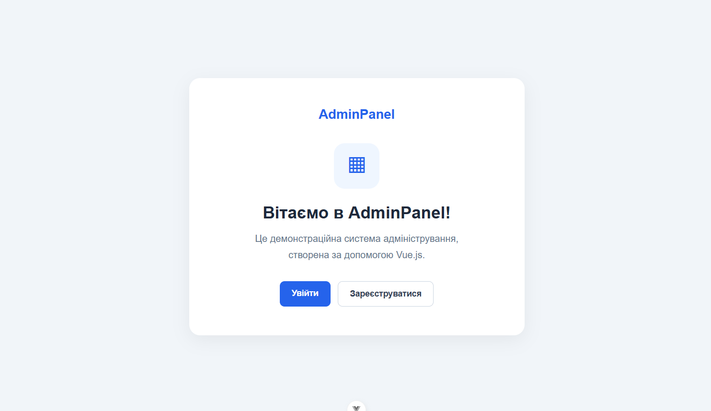
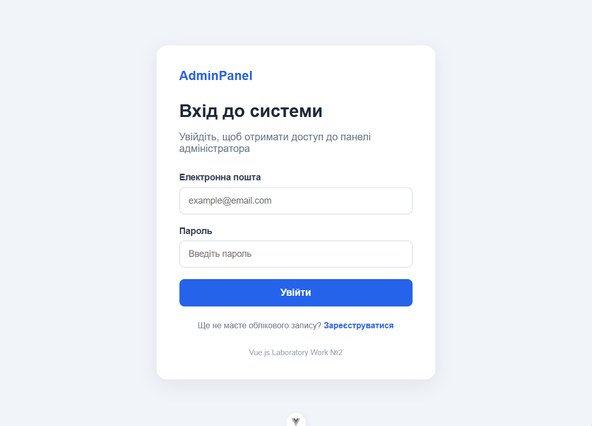
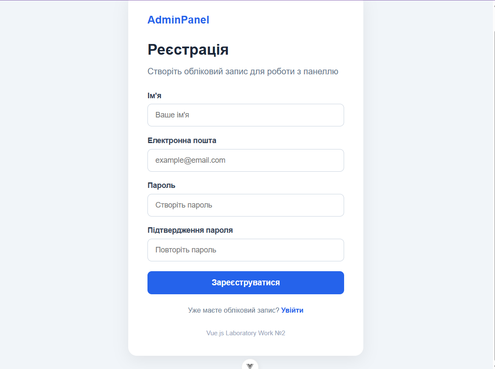
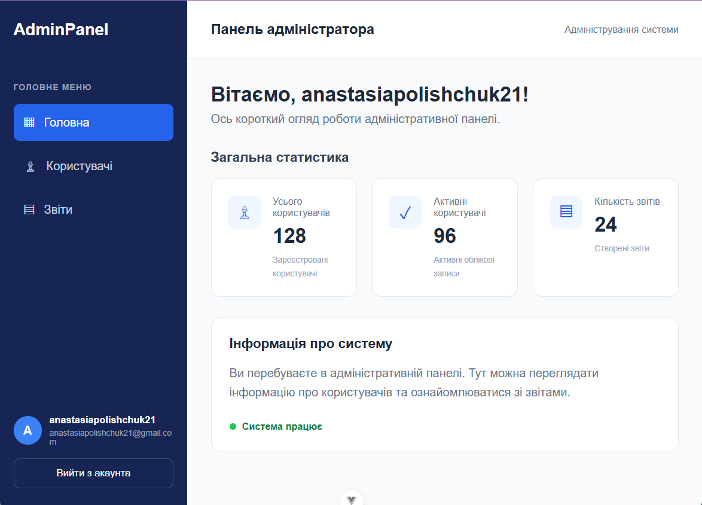
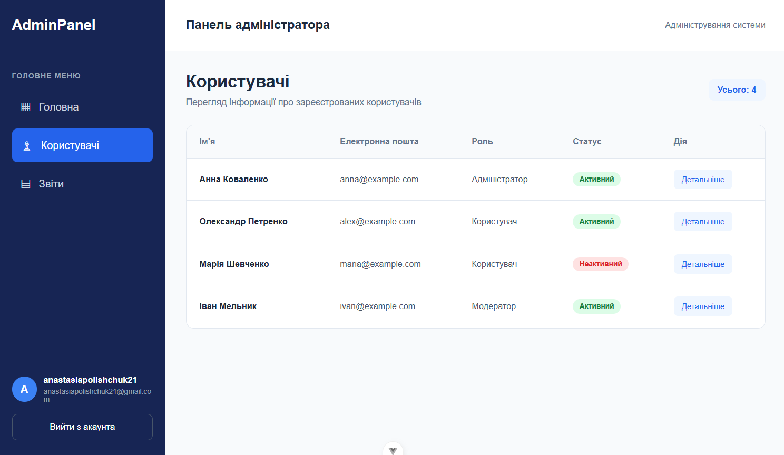
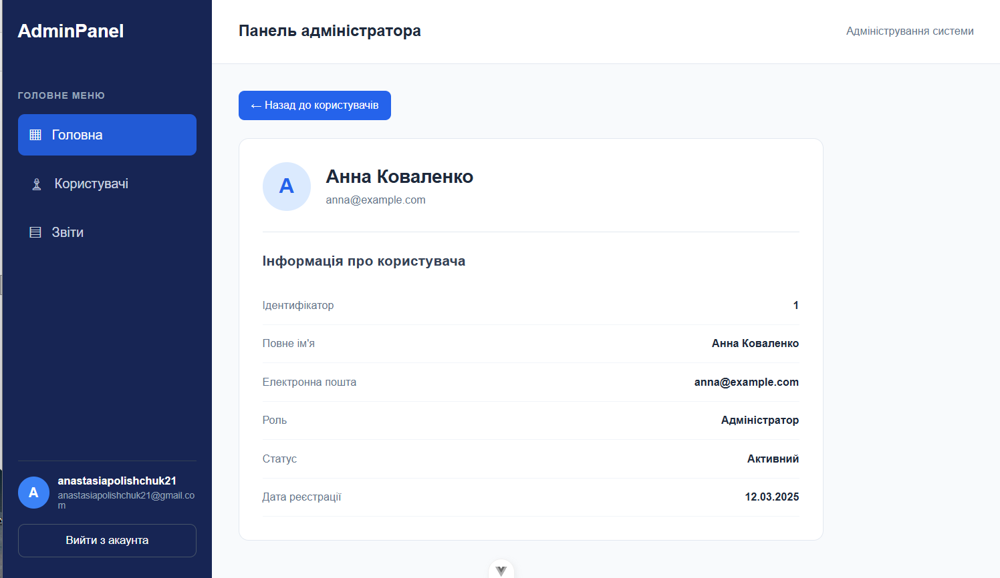
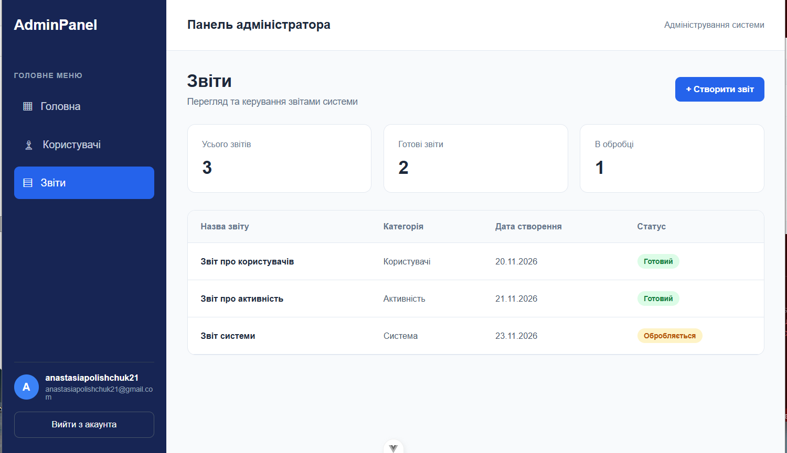

# Лабораторна робота №2
## Взаємодія компонентів та маршрутизація у Vue.js

### Мета роботи
Ознайомитися з механізмами взаємодії компонентів у Vue.js, навчитися використовувати props, emits, v-model, provide/inject, слоти та налаштовувати маршрутизацію за допомогою Vue Router.

### Опис проєкту
Розроблено демонстраційну адміністративну панель AdminPanel на основі Vue 3 та Vue Router 4.

Застосунок містить:
- головну сторінку;
- сторінки входу та реєстрації;
- панель адміністратора;
- інформаційну панель Dashboard;
- список користувачів;
- сторінку перегляду окремого користувача;
- розділ звітів;
- сторінку помилки 404.

Авторизація реалізована в демонстраційному режимі з використанням localStorage, без підключення зовнішнього сервера.

### Технології
- Vue 3 (Composition API);
- Vue Router 4;
- JavaScript;
- Vite;
- HTML5;
- CSS3;
- localStorage.

### Встановлення та запуск

1. Відкрити папку проєкту lab2 у Visual Studio Code.
2. Відкрити термінал.
3. Встановити залежності:

   ```bash
   npm install
   ```

4. Запустити проєкт:

   ```bash
   npm run dev
   ```

5. Відкрити адресу, яку виведе термінал, зазвичай http://localhost:5173/.

### Реалізація вимог лабораторної

**1. Props та Emits**

У компоненті UserCard.vue використовується defineProps() для отримання даних користувача та defineEmits() для передавання події view-details батьківському компоненту UsersView.vue.

**2. V-model та defineModel()**

У компоненті BaseInput.vue використовується defineModel() для двостороннього зв'язку між полем введення та батьківським компонентом. Компонент застосовується на сторінках входу та реєстрації.

**3. Provide та Inject**

У компоненті App.vue за допомогою provide() передаються дані поточного користувача та функції керування ними. Компоненти LoginView.vue, RegisterView.vue, AdminLayout.vue і DashboardView.vue отримують ці дані через inject().

**4. Slots**

У компоненті AuthLayout.vue використовується слот <slot />, який дозволяє передавати різний вміст форм входу та реєстрації в спільний шаблон.

**5. Маршрутизація**

Для навігації використовується Vue Router 4. Реалізовано:
- публічні маршрути;
- захищений маршрут адміністративної панелі;
- вкладені маршрути;
- динамічний маршрут окремого користувача;
- lazy loading компонентів;
- перенаправлення неавторизованих користувачів;
- сторінку 404;
- автоматичне прокручування сторінки до початку.

**6. Авторизація**

Реалізовано демонстраційний вхід і реєстрацію з перевіркою заповнення полів та збігу паролів. Стан авторизації зберігається у localStorage.

### Результати тестування

Перевірено:
- відкриття головної сторінки;
- реєстрацію та перевірку збігу паролів;
- вхід до адміністративної панелі;
- відображення даних авторизованого користувача;
- навігацію між розділами;
- перегляд інформації про окремого користувача;
- створення звітів;
- вихід з облікового запису;
- захист адміністративних маршрутів;
- відображення сторінки 404.

Усі перевірені функції працюють коректно.

### Висновок

Під час виконання лабораторної роботи було розроблено демонстраційну адміністративну панель на Vue.js. Закріплено навички створення компонентів, передавання даних за допомогою props та emits, використання v-model, provide/inject і слотів. Налаштовано маршрутизацію за допомогою Vue Router, зокрема вкладені, динамічні та захищені маршрути. Проведено перевірку основних функцій застосунку.

### Скріншоти роботи застосунку

**1. Головна сторінка**



**2. Сторінка входу**



**3. Сторінка реєстрації**



**4. Панель адміністратора**



**5. Список користувачів**



**6. Інформація про користувача**



**7. Сторінка звітів**

