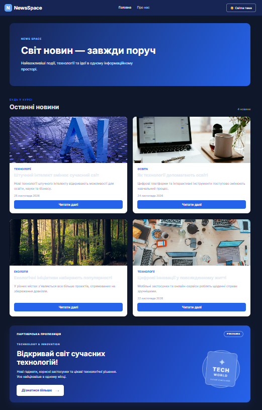
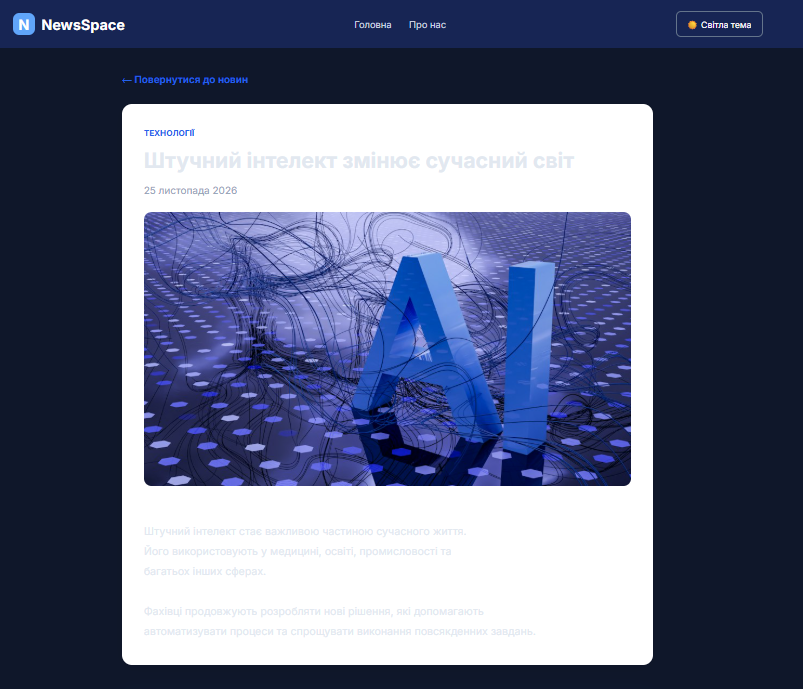
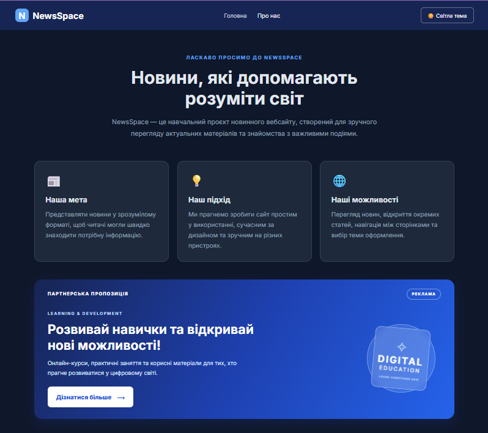
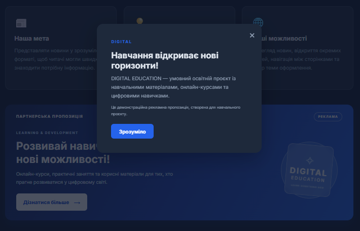
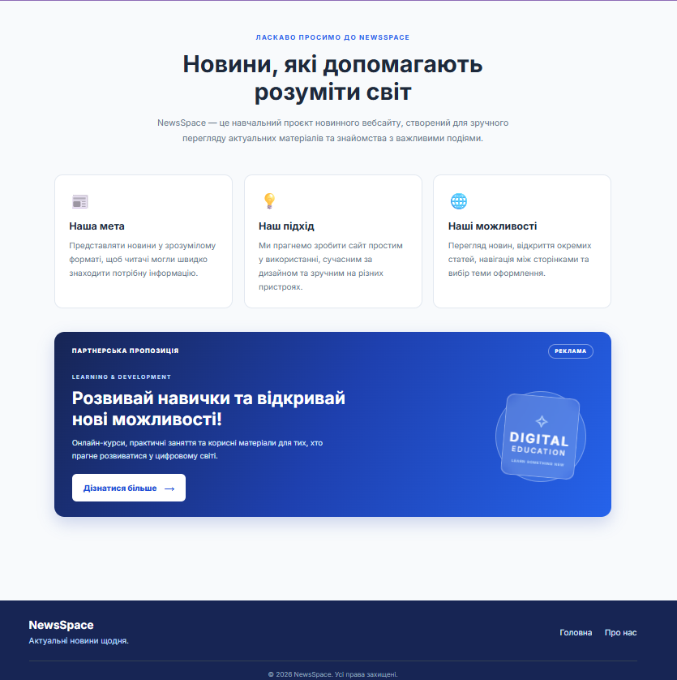
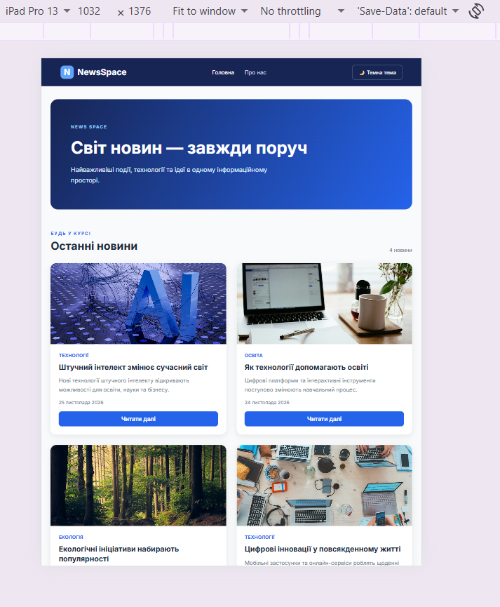
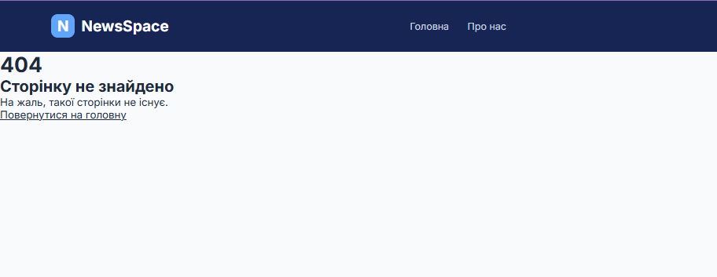

# Лабораторна робота №3. Стилізація компонентів Vue.js

## Опис проєкту

У межах лабораторної роботи розроблено вебзастосунок на Vue.js із багатосторінковою структурою та стилізованим користувацьким інтерфейсом.

Основна увага приділена оформленню компонентів, узгодженості дизайну між сторінками, адаптивності інтерфейсу та реалізації різних режимів відображення.

## Реалізований функціонал

У проєкті реалізовано:

- **Головну сторінку** з навігацією та основним вмістом вебзастосунку.
- **Сторінку статті** з окремим оформленням текстового матеріалу.
- **Сторінку «Про нас»** з інформацією про проєкт.
- **Модальне вікно реклами** для відображення додаткового інформаційного повідомлення.
- **Світлу та темну теми** з можливістю перемикання оформлення.
- **Адаптивний дизайн**, який забезпечує коректне відображення інтерфейсу на різних розмірах екранів.
- **Сторінку 404** для обробки переходів на неіснуючі маршрути.

## Використані технології

| Технологія | Призначення |
|---|---|
| Vue.js 3 | Створення компонентного інтерфейсу |
| JavaScript | Реалізація інтерактивності |
| HTML5 | Структура сторінок |
| CSS3 | Стилізація компонентів та адаптивність |
| Vue Router | Маршрутизація між сторінками |
| Vite | Розробка та запуск проєкту |

## Встановлення та запуск

Для локального запуску проєкту необхідно виконати такі дії:

**1. Клонувати репозиторій:**

```bash
git clone https://github.com/anastasiaIgorivna/VueJSLabs2026.git
```

**2. Перейти до директорії лабораторної роботи:**

```bash
cd VueJSLabs2026/lab3
```

**3. Встановити необхідні залежності:**

```bash
npm install
```

**4. Запустити сервер розробки:**

```bash
npm run dev
```

**5.** Відкрити адресу, зазначену в терміналі (зазвичай `http://localhost:5173/`).

## Демонстрація роботи

### 1. Головна сторінка

Головна сторінка вебзастосунку з основною навігацією та реалізованим оформленням у темній темі.



### 2. Сторінка статті

Відображення окремої сторінки статті з відповідним оформленням контенту.



### 3. Сторінка «Про нас»

Інформаційна сторінка з окремою структурою та стилізацією.



### 4. Модальне вікно реклами

Демонстрація модального вікна з рекламним повідомленням та його відображення в інтерфейсі.



### 5. Світла тема

Приклад альтернативного оформлення вебзастосунку зі світлою кольоровою схемою.



### 6. Адаптивність інтерфейсу

Перевірка відображення вебзастосунку на екрані меншого розміру.



### 7. Сторінка 404

Відображення сторінки помилки під час переходу на маршрут, якого не існує.



## Висновок

У ході виконання лабораторної роботи було закріплено практичні навички стилізації компонентів у Vue.js та роботи з CSS. Реалізовано оформлення декількох сторінок вебзастосунку, модальне вікно, світлу й темну теми, адаптивне відображення та сторінку обробки неіснуючих маршрутів.

Під час роботи було досліджено особливості використання глобальних стилів і локальної стилізації компонентів за допомогою атрибута `scoped`. Глобальні стилі дозволяють задавати спільне оформлення для всього застосунку, тоді як локальні обмежують дію CSS конкретним компонентом, що допомагає уникати конфліктів стилів.

Отже, Vue.js забезпечує зручну організацію стилізації компонентного інтерфейсу, а поєднання CSS, адаптивних правил та реактивних можливостей Vue.js дозволяє створювати функціональні й зручні вебзастосунки.

---

**Автор:** Поліщук Анастасія Ігорівна  
**Група:** ЗІПЗ-23-1  

