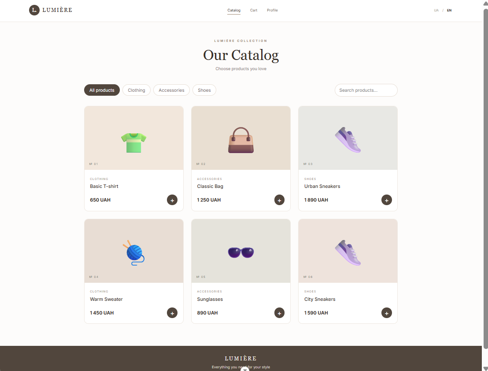
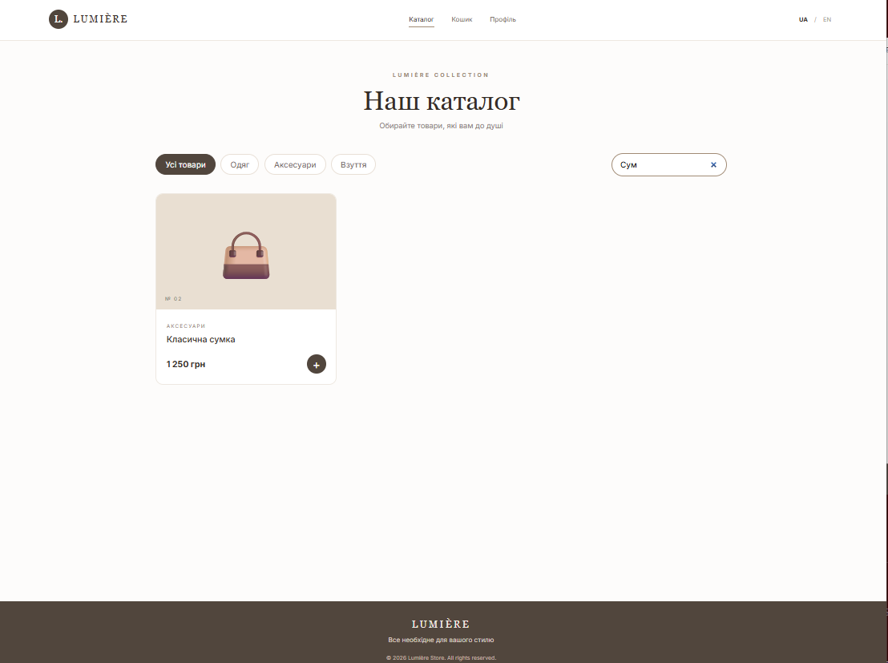
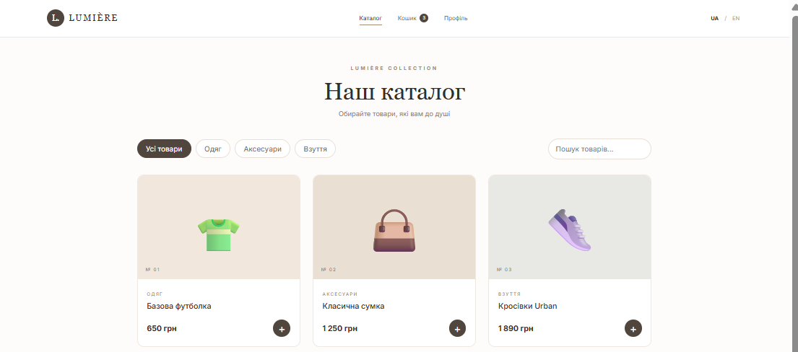
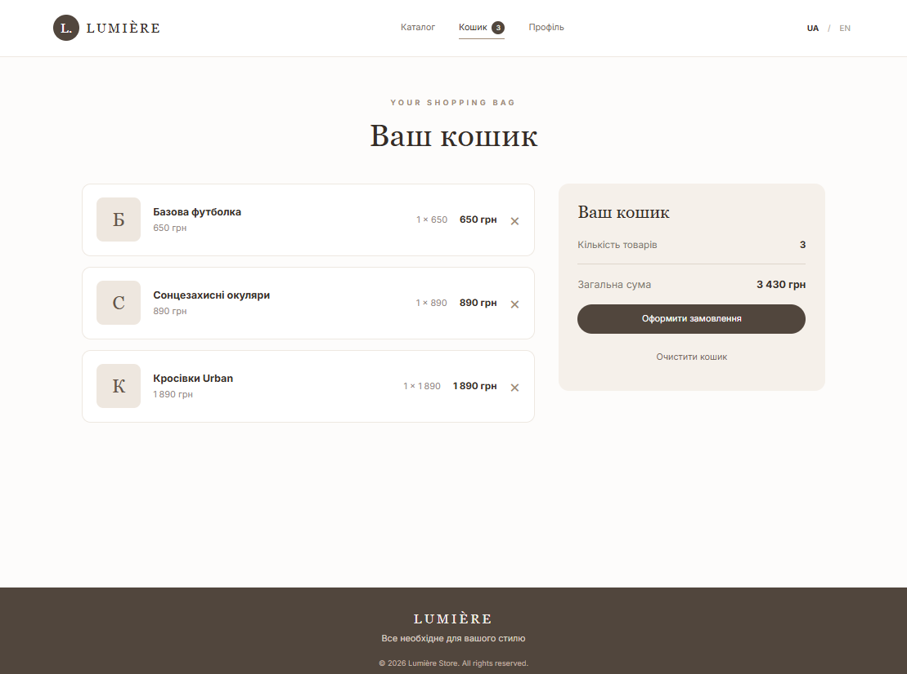
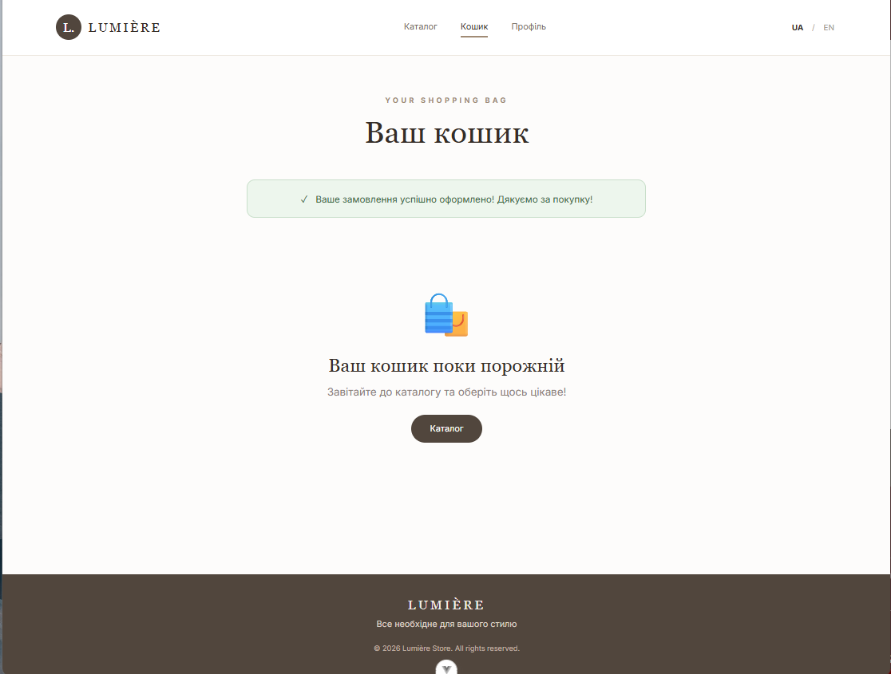
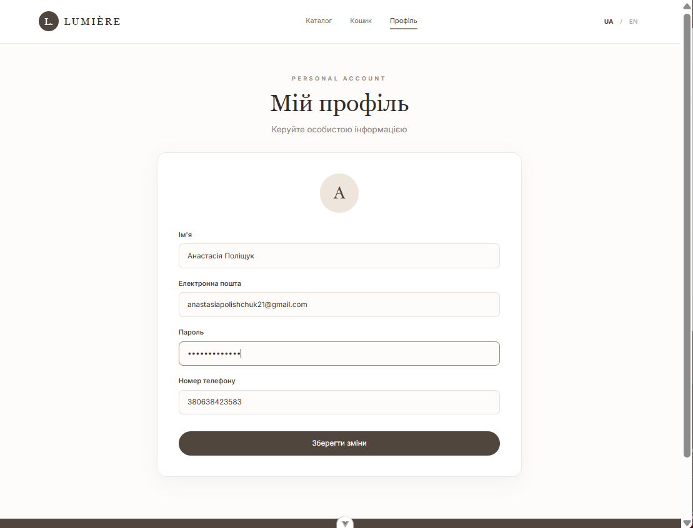
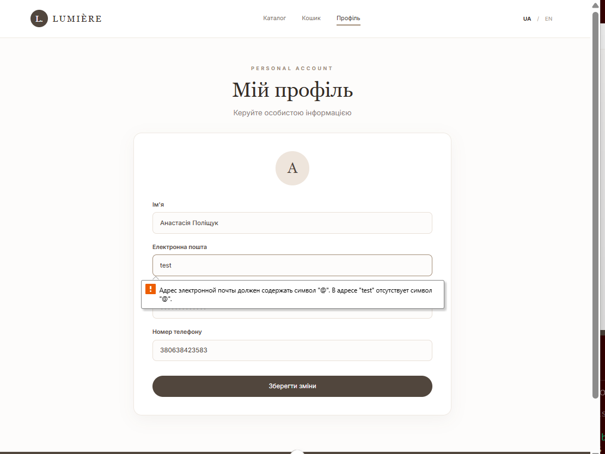
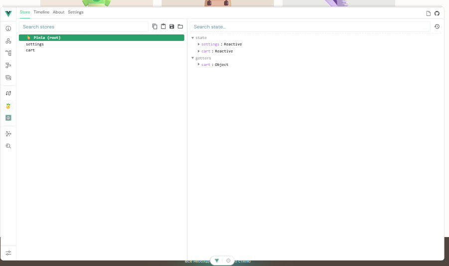
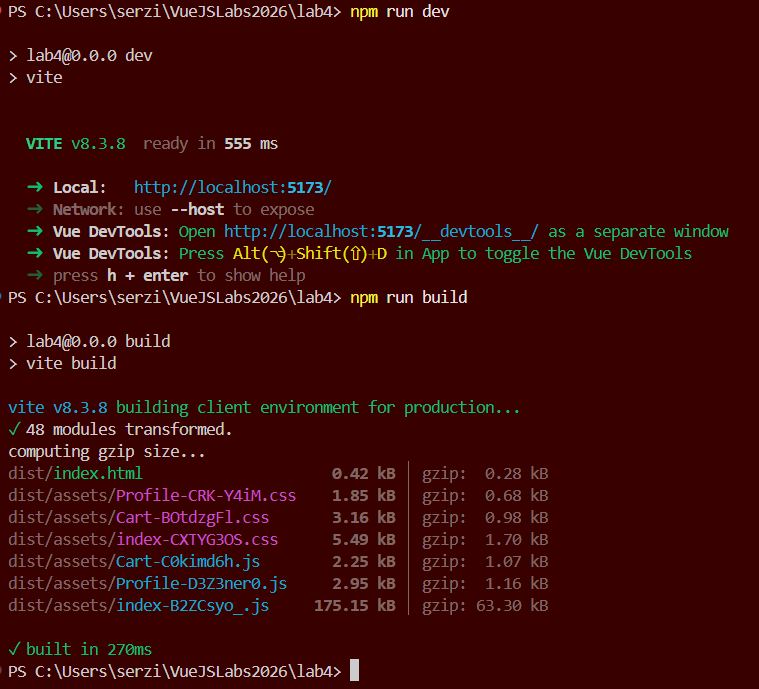

# Лабораторна робота №4
## Керування станом за допомогою Pinia та локалізація інтерфейсу за допомогою vue-i18n

**Назва проєкту:** Lumière Store

---

## 1. Мета роботи

Ознайомитися з бібліотекою Pinia для централізованого керування станом у застосунках Vue 3, навчитися створювати сховища даних, використовувати getters та actions, реалізувати збереження стану за допомогою localStorage, а також ознайомитися з локалізацією інтерфейсу за допомогою vue-i18n.

## 2. Опис розробленого застосунку

У межах лабораторної роботи розроблено вебзастосунок **Lumière Store** — інтернет-магазин одягу, взуття та аксесуарів.

Застосунок створено з використанням Vue 3 та Composition API. Він надає користувачеві можливість переглядати каталог товарів, здійснювати пошук, фільтрувати товари за категоріями, додавати їх до кошика, переглядати загальну вартість покупок та оформлювати демонстраційне замовлення.

Також реалізовано сторінку профілю користувача з перевіркою введених даних і можливістю перемикання мови інтерфейсу.

## 3. Використані технології

Під час розробки застосунку використано такі технології та інструменти:

- **Vue 3** — створення компонентів та інтерфейсу користувача.
- **JavaScript** — реалізація функціональності застосунку.
- **Composition API** — організація логіки компонентів.
- **Vite** — інструмент розробки та збирання проєкту.
- **Vue Router** — реалізація навігації між сторінками.
- **Pinia 2** — централізоване керування станом застосунку.
- **pinia-plugin-persistedstate** — збереження стану сховищ у localStorage.
- **vue-i18n 9** — реалізація багатомовності.
- **CSS** — стилізація та адаптивне оформлення інтерфейсу.

## 4. Реалізація керування станом за допомогою Pinia

Для керування станом застосунку створено два сховища Pinia.

### 4.1. Сховище налаштувань користувача

У файлі `src/stores/settings.js` реалізовано сховище `settings`, яке відповідає за збереження налаштувань користувача.

Сховище містить:
- поточну мову інтерфейсу;
- дані профілю користувача;
- налаштування теми оформлення.

Для зміни даних реалізовано відповідні actions, зокрема `setLocale()`, `setProfile()` та `setTheme()`.

Збереження налаштувань реалізовано за допомогою плагіна `pinia-plugin-persistedstate`.

### 4.2. Сховище кошика

У файлі `src/stores/cart.js` створено сховище `cart`, яке забезпечує керування товарами в кошику.

Кожен товар містить такі властивості:
- `id` — ідентифікатор товару;
- `title` — назва товару;
- `price` — ціна;
- `qty` — кількість одиниць товару.

У сховищі реалізовано:

**Getters:**
- `totalCount` — обчислення загальної кількості товарів;
- `totalPrice` — обчислення загальної вартості товарів.

**Actions:**
- `add()` — додавання товару до кошика або збільшення його кількості;
- `remove()` — видалення товару;
- `clear()` — повне очищення кошика.

Стан кошика зберігається в localStorage, тому додані товари залишаються після перезавантаження сторінки.

## 5. Реалізація локалізації за допомогою vue-i18n

Для забезпечення багатомовності інтерфейсу використано бібліотеку `vue-i18n`.

Конфігурацію локалізації винесено у файл `src/i18n.js`.

Для перекладів створено два окремі файли:
- `src/locales/ua.js` — українська локалізація;
- `src/locales/en.js` — англійська локалізація.

У головному компоненті `App.vue` реалізовано перемикач мов UA та EN. Поточна мова синхронізується зі сховищем Pinia.

Текстові елементи сторінок отримують переклади за допомогою функції `t()`.

## 6. Реалізований функціонал застосунку

### 6.1. Каталог товарів

Реалізовано:
- відображення каталогу товарів;
- пошук за назвою;
- фільтрацію за категоріями;
- додавання товарів до кошика;
- повідомлення про успішне додавання товару.

### 6.2. Кошик

Реалізовано:
- відображення доданих товарів;
- підрахунок кількості товарів;
- автоматичне обчислення загальної вартості;
- видалення окремих товарів;
- очищення всього кошика;
- демонстраційне оформлення замовлення з повідомленням про успіх та автоматичним очищенням кошика.

### 6.3. Профіль користувача

Створено форму для введення:
- імені;
- електронної пошти;
- пароля;
- номера телефону.

Реалізовано перевірку введених даних, відображення повідомлень про помилки та повідомлення про успішне збереження профілю.

## 7. Тестування застосунку

Після реалізації функціональності проведено перевірку основних можливостей вебзастосунку.

Під час тестування перевірено:

1. Коректне відображення каталогу товарів.
2. Роботу пошуку та фільтрації.
3. Додавання товарів до кошика.
4. Обчислення загальної кількості та вартості товарів.
5. Видалення товарів та очищення кошика.
6. Збереження стану після перезавантаження сторінки.
7. Роботу демонстраційного оформлення замовлення.
8. Перевірку даних у формі профілю.
9. Перемикання між українською та англійською мовами.

Додатково виконано перевірки проєкту за допомогою команд:

```bash
npm run build
npm run lint
```

Обидві перевірки завершилися успішно, помилок під час збирання та перевірки коду не виявлено.

## 8. Скріншоти роботи застосунку

### 8.1. Каталог товарів



### 8.2. Пошук і фільтрація товарів



### 8.3. Додавання товарів до кошика



### 8.4. Кошик із доданими товарами



### 8.5. Успішне оформлення замовлення



### 8.6. Профіль користувача



### 8.7. Перевірка введених даних у профілі



### 8.8. Сховища Pinia у Vue DevTools



### 8.9. Результат production-збірки



## 9. Інструкція із запуску проєкту

Для запуску застосунку необхідно:

**1. Встановити залежності:**

```bash
npm install
```

**2. Запустити режим розробки:**

```bash
npm run dev
```

**3. Відкрити адресу, яку виведе Vite у терміналі, зазвичай:**

```text
http://localhost:5173/
```

**4. Для створення production-збірки виконати:**

```bash
npm run build
```

**5. Для перевірки коду виконати:**

```bash
npm run lint
```

## 10. Висновок

Під час виконання лабораторної роботи було розроблено вебзастосунок Lumière Store із використанням Vue 3. Практично опрацьовано централізоване керування станом за допомогою Pinia, створення сховищ, використання getters та actions, а також збереження даних у localStorage.

За допомогою бібліотеки vue-i18n реалізовано українську та англійську локалізації інтерфейсу. Створено каталог товарів, кошик і сторінку профілю користувача. Перевірено роботу основних функцій застосунку, виконано production-збірку та перевірку коду за допомогою ESLint.

У результаті закріплено практичні навички використання Pinia та vue-i18n у застосунках Vue 3.
